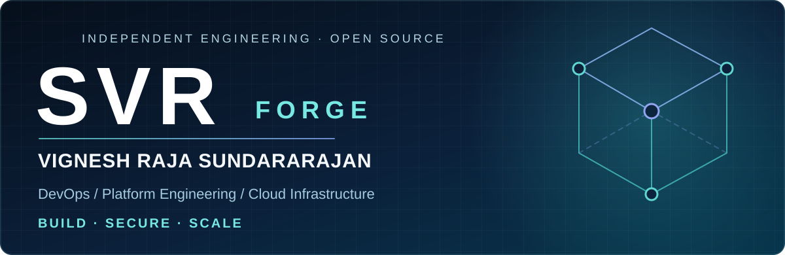

### SVR / BUILD · SECURE · SCALE

**SVR Forge** — my independent open-source engineering lab for practical DevOps, cloud and developer tooling.

## About me

I'm **Vignesh Raja Sundararajan**, a DevOps and Platform Engineer with **3+ years of experience** focused on infrastructure reliability, CI/CD automation, deployment operations and cloud engineering.

My primary work is in **DevOps, SRE and Platform Engineering**. I also explore **developer productivity tools, automation and web experiences**. I prefer small, understandable tools that solve an actual workflow over impressive-looking demos with no clear use.

- **Infrastructure:** Oracle Cloud Infrastructure (OCI), Kubernetes, Docker, Terraform
- **Delivery:** Jenkins, GitHub Actions, Git, CI/CD and release workflows
- **Operations:** Production troubleshooting, deployment validation, observability and operational security
- **Currently exploring:** Offline-first developer tooling and AI-assisted engineering workflows
- **Also interested in:** Modern web development and interface design

> Design for reliability. Automate the repetitive. Make the evidence visible.

## SVR Forge · Original Projects

The five **SVR Forge** projects below were written as **independent learning utilities** for engineers. They're currently separate folders in this public profile repository—not yet separate GitHub repositories. Each includes code, examples, documentation and unit tests.

| Project | Engineering problem | Focus |
| :--- | :--- | :--- |
| **[Release Snapshot Checker](./labs/release-snapshot-checker/)** | Review Kubernetes deployment snapshots before release | Deployments, image tags, replicas, readiness |
| **[Kube Drift Diff](./labs/kube-drift-diff/)** | Compare desired and observed Kubernetes specs | Drift detection without displaying field values |
| **[Dockerfile Doctor](./labs/dockerfile-doctor/)** | Find common container build hygiene issues | Base images, USER, risky install patterns |
| **[Terraform Risk Radar](./labs/terraform-risk-radar/)** | Review common risky infrastructure-as-code patterns | CIDRs, credential literals, TLS settings |
| **[Actions Workflow Guard](./labs/actions-workflow-guard/)** | Review GitHub Actions workflow hygiene | Permissions, action pins, workflow triggers |

**[Explore the complete DevOps Lab, run commands and test instructions](./labs/)**

> These tools are educational, read-only, offline heuristics—not production security certifications or replacements for specialist scanners. No cloud credentials are required.

## Engineering toolkit

**Cloud & infrastructure**

**Automation & delivery**

## How I work

**Build:** Minimal, reproducible examples that you can understand and run locally.

**Verify:** Automated checks, observable behavior, documented limitations and safe defaults.

**Collaborate:** Actionable issue reports, focused pull requests and respectful feedback.

## Open source & collaboration

Interested in DevOps, SRE, Kubernetes, OCI, platform tooling or AI developer workflows? Feel free to [open a discussion through GitHub issues](https://github.com/devopsvikki/devopsvikki/issues) or explore the [source code](./labs/).

Contributions welcome. Please review [Contributing](./CONTRIBUTING.md), [Security](./SECURITY.md) and [Code of Conduct](./CODE_OF_CONDUCT.md).

**SVR Forge · Vignesh Raja Sundararajan · @devopsvikki**

*Reliable systems. Thoughtful automation. Useful software.*

